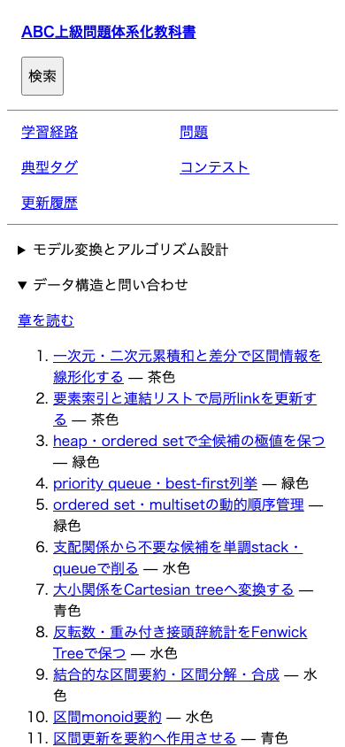
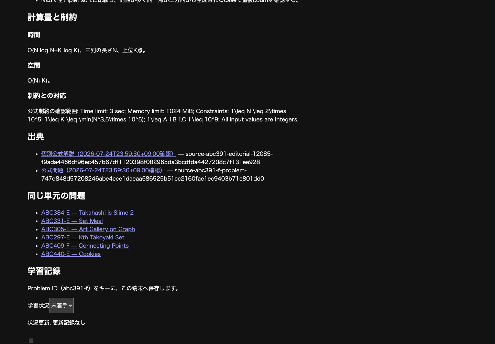

# 読書体験の診断と比較基準

[Issue #108](https://github.com/Fu-L/abc-textbook/issues/108)の診断。背景は[Study UX Epic #107](https://github.com/Fu-L/abc-textbook/issues/107)。ABCの過去問から難関コンテストへ進む読者が、典型の成立条件・発想・証明を学び、次の問題を選べることを評価する。装飾の多さや表示件数を成果にしない。

確認日: 2026-10-17。改善前の教材・UIは `1abfe747694f3196c09220512072bd57dd226a36`（#106
merge後のmain）。本PRはこの診断と実画面を追加し、公開画面・教材・分類・学習記録の実装を変更しない。したがって本PR前後の表示は同じであり、以下を後続PRのBeforeとして使う。Afterや学習効率向上の実績はまだない。

## 比較する画面と条件

全画像は同じGit版を本番設定 `SITE_URL=https://fu-l.github.io BASE_PATH=/abc-textbook`
でbuildし、ローカルのAstro
previewから撮影した。Epicに添付された元スクリーンショットの再掲ではない。画像はviewport全体のPNGで、本文・余白・色を加工していない。

- macOS arm64、Node 24.18.0、npm 11.19.0、Playwright 1.61.1 / Chromium
  149.0.7827.55。システムフォントを使い、別OSでの字形差は許容する。
- PC: 1440×1000 CSS px、スマホ相当: 390×844 CSS px、device scale
  factorは両方1。実機スマホの検証ではない。
- `locale=ja-JP`、`timezoneId=Asia/Tokyo`、`reducedMotion=reduce`。ライト／ダークはOSの
  `prefers-color-scheme` 相当を切り替える。テーマ切替UIは現行サイトにない。
- ページ読込・フォント準備・学習記録controlの有効化を待つ。先頭はscrollY=0。節の画像は見出し／要素を上端から32pxに置く。ただし末尾ではスクロール上限を使う。
- 画像ごとに空の使い捨てbrowser contextを使用。学習記録の画像だけABC391
  Fを「修了」「要復習」にし、reload後に操作可能になった状態を撮影。日時は既存E2Eと同じ
  `2026-07-14T12:00:00+09:00` に固定した架空の記録で、私的データを含まない。

表のパスはすべて公開base `/abc-textbook/` の後へ続く。先頭・節・末尾を混同して比較しない。

| 画面・読み取り対象             | パスと撮影位置                                        | 改善前の実画面                                                                                                        |
| ------------------------------ | ----------------------------------------------------- | --------------------------------------------------------------------------------------------------------------------- |
| ホーム: 学び方と入口           | `/`、先頭                                             | [PC・light](study-ux-baseline/home-desktop-light.png)                                                                 |
| 分野別目次: 読む章・単元       | `/learn/`、先頭                                       | [PC・light](study-ux-baseline/contents-desktop-light.png)                                                             |
| 代表Unit: 概念と本文への到達   | `/learn/query/priority-queue-best-first/`、先頭       | [PC・light](study-ux-baseline/unit-desktop-light.png)、[スマホ・light](study-ux-baseline/unit-mobile-light.png)       |
| 代表Unit: 日本語と式を通読     | 同上、`#考え方`                                       | [スマホ・light](study-ux-baseline/unit-concept-mobile-light.png)                                                      |
| full問題: 最初に見える情報     | `/problems/abc391-f/`、先頭                           | [PC・light](study-ux-baseline/problem-desktop-light.png)、[スマホ・light](study-ux-baseline/problem-mobile-light.png) |
| full問題: 制約の数式と出典     | 同上、`#計算量と制約`                                 | [PC・dark](study-ux-baseline/problem-math-desktop-dark.png)                                                           |
| 長いUnit: 問題の選び分け       | `/learn/query/range-monoid-aggregation/`、`#問題一覧` | [スマホ・dark](study-ux-baseline/long-unit-mobile-dark.png)                                                           |
| 擬似コード: 行と字下げ         | `/problems/abc251-f/`、最初の `pre`                   | [スマホ・light](study-ux-baseline/code-mobile-light.png)                                                              |
| 長い表: 横スクロールと代替一覧 | `/contests/abc212/`、`.matrix-scroll`                 | [スマホ・dark](study-ux-baseline/table-mobile-dark.png)                                                               |
| 学習記録: 保存後の確認         | `/problems/abc391-f/`、`#learning-record-heading`     | [PC・dark](study-ux-baseline/records-desktop-dark.png)                                                                |
| similar形式の参照先導線        | 同上の表示用fixture、`#explanation`                   | [スマホ・light、未掲載fixture](study-ux-baseline/similar-fixture-mobile-light.png)                                    |
| 拡大時のreflow                 | `/problems/abc391-f/`、`#考察`、720×500 CSS px        | [PCの200%相当のレイアウト幅・light](study-ux-baseline/reflow-720-light.png)                                           |

### similarの範囲と限界

現行868問題の `authoringUnit.kind` はすべて
`full`。掲載済みのsimilar問題はない。末尾の「同じ単元の問題」も、解説形式としての `similar`
とは別である。

上のfixtureは、既存の [`renderPublicDocument`](../../src/lib/catalog/render-public-document.ts) に
`authoringUnit: {"kind":"similar","primaryProblemId":"abc391-f"}`
と「主要解説との差分」「実装上の注意」の表示確認文を渡して生成したHTMLを、使い捨てブラウザー内の
`.authored-content`
だけに差し替えたもの。画面内にも「表示確認用fixture（未掲載・分類判断を含まない）」と明記した。正本・dist・配置policyには保存していない。参照元リンクの表示・移動とブラウザーの「戻る」を確認した。遷移後の再読込ではDOMの差し替えは消える。

fixtureで確認できるのは共通表示と導線だけ。similarとしての解法・成立条件・証明・計算量の同一性、差分からの学習効果は未評価。実教材が追加されたら、その問題と参照元のfullを同じ試用手順で比較する。形式自体の公開loader検証は既存の
[`full-public-projection.test.ts`](../../tests/integration/full-public-projection.test.ts) にある。

## 実画面から分かった阻害要因

数値はこの環境の位置・CSSの観測値であり、可読性の点数ではない。とくに「16pxだから不合格」とは判断しない。行幅、行送り、情報順、実際の読み取りを合わせて判断する。

### 文字組みと情報の優先順位

本文のcomputed styleは
`font-size: 16px`、`line-height: normal`、`font-family: Times`。日本語の字形はOSのfallbackに依存する。`global.css`
は `--sl-font` を定義するが、独自の `TextbookLayout` のbodyへ `font-family`
として適用していない。Starlight向け `.sl-markdown-content` の幅・コード指定も、主教材の
`.authored-content` へそのままは適用されない。変数の調整だけで改善済みとしない。

PCのホーム説明文は幅1216px、Unit本文は約799px、スマホ本文は350px。`76ch`
は日本語の76文字ではない。長い日本語と英語識別子・式が同じ段落で続き、視線の折り返し先を追う負担がある。見出しは既定のサイズ差で識別できる一方、主題・技能の繰返しも本文と同程度に強く見える。

| 観測                                                                                                                                       | 学習タスクへの影響                                                                                                 | 後続の対象                     |
| ------------------------------------------------------------------------------------------------------------------------------------------ | ------------------------------------------------------------------------------------------------------------------ | ------------------------------ |
| ABC391 Fの「考察」はPCの文書上端1020px、スマホ1428px。「解説」自体も801px / 1137pxから。先に掲載状態・日時・技能の空欄・タグ・執筆版が並ぶ | 問題の核心へ入る前に管理情報を読み分ける。本文内の「学習の位置」でも主題説明が繰り返される                         | #109 文字組み、#113 情報階層   |
| スマホの代表Unitのh1は1947pxから。現在章の目次が本文より先に展開される                                                                     | 直接Unit URLを開いても単元名・学ぶ内容が最初の画面にない。skip linkも目次への往復を助ける案内としては見つけにくい  | #116 目次・現在位置、#118 入口 |
| 代表Unitの「概要」「習得する技能」「前提と範囲」と問題各行で同じ主題説明を反復                                                             | 概念の説明と問題ごとの差が埋もれる。初見問題で使う条件を抽出しづらい                                               | #114 単元、#115 一覧           |
| 長いUnitはスマホで約13787px。主配置16問の後に関連問題が続き、各行で同じOutcomeを反復                                                       | 類題のID・題名・何が変わるかを見比べるためのスクロールが多い。関連先とhomeの違いは残す必要がある                   | #115 一覧、#117 本文内目次     |
| サイドバーは現在単元に `aria-current` があるが、本文内目次がない。単元ページから `previous` / `next` を渡していない                        | 長い本文の途中から成立条件や章の読書順へ戻るには、スクロールやブラウザー検索に頼る                                 | #116、#117                     |
| 学習記録はABC391 FのPC約2955px、スマホ約4158px以降。出典と関連問題の後にある                                                               | 問題を解いて戻ったとき、状態だけ更新する場所を探す。本文の先頭へ大きな操作UIを置くと通読を妨げるトレードオフもある | #113、#119                     |



### 数式の表示と、文章による導出を分ける

ABC391 Fの制約で `1\leq N \leq 2\times 10^5`
などがTeXコマンドのまま露出する。rendererは記号をMarkdownに壊されないよう保護するが、この経路には数式を組版するprocessorがない。今回の問題ページで
`math` / `.katex` / `mjx-container`
は0件。数式の意味・上下添字・集合記号を追いにくい**表示の不具合**として #110 で扱う。保護処理を単に削って添字や乗算をMarkdownへ誤変換する解決は避ける。

一方、ABC391 Fの `f(i,j,k)`、単調性、三近傍の記述は既に本文にあるが、`frontier`・`grid`
等の初出説明が薄く、`(1,1,1)`
と0始まりの手順が続く。探索境界が未列挙の最大値を代表する理由を自分で再構成する負担がある。これは字体や数式rendererを変えても残る**説明の課題**として #120
/ #121 に渡す。今回、解法の誤りと断定したり、本文を訂正したりはしていない。



### コード・表と操作

ABC251 Fの擬似コードは `.authored-content pre { white-space: pre-wrap; }`
で自動改行する。350px幅では一つの処理行が次行へ流れ、元の字下げと画面上の折り返しを区別しにくい。コードは既定の等幅字体で本文より小さい。文書全体の横はみ出しが0でも、手順を読む品質には問題が残る。#111ではコードの改行・字下げを保つことと、狭い画面で局所スクロールが必要になることを比較する。

ABC212の表は最小幅72remの領域内で横スクロールし、文書全体は390px内に収まる。ただし行見出しが細く折れ、横に続く列の存在が読み取りにくい。直下の「コンテスト別リスト」という代替表示は残したい。コードの局所スクロールと表のスクロールを、本文まで横へ動く状態と混同しない。

ライト／ダークではOS既定のCanvas・文字・リンク色を使って切り替わる。今回の画像で文字とリンクは区別できたが、配色・コントラストの全面監査はしていない。キーボードの最初のTabで「本文へ移動」が表示され、検索を開いて入力・Escapeで閉じる操作、JS無効時の本文・公式出典・単元リンクと検索の無効表示は確認できた。

## 簡単な読み取りタスク

同じ読者がBefore→Afterで同じ内容を読むと、二度目は答えを覚えている。秒数の単純比較を学習効率と見なさない。操作の迷い、読み返した箇所、答えに至った本文を各タスク一行で記す。必要なら表示する版をA/Bと呼び、順を入れ替える。正解数の合計や重み付きスコアは作らない。

| タスクと開始点                        | 操作・読み取り                                                                 | 読みやすさを判断する具体的な到達点                                                                               | 今回のCodexによる診断                                                                     |
| ------------------------------------- | ------------------------------------------------------------------------------ | ---------------------------------------------------------------------------------------------------------------- | ----------------------------------------------------------------------------------------- |
| 単元を理解する: ホーム                | 「分野別の教科書目次」から代表Unitへ進み、「考え方」を読む                     | 単元名・学ぶこと・概念上の親が見つかる。heapに残す候補と、次の候補が全体の最小になる理由を本文を指して説明できる | 本文は存在し例もある。スマホ先頭は章目次で占有され、概念説明への到達にスクロールが要る    |
| 問題を解く: 代表Unit                  | 一覧のABC391 Fを開く。公式問題と考察を読み、状態・遷移・重複管理・計算量を探す | 三つの添字と優先値、三近傍、同一状態の重複と同値の別状態の違いをたどれる。公式問題をすぐ開ける                   | Unit→問題の内部導線は動作。考察は最初の画面より下。発想の導出は表示改善と分けて再評価する |
| 類題を探す: ABC391 F                  | 「同じ単元の問題」または主題Unitに戻り、ABC297 Eを見つけて両解説を開く         | 各問題の解説へ到達し、共通の典型と異なる条件を本文から比較できる。関連参照を必須履修と誤解しない                 | ID・題名のリンクはあるが、一覧だけでは各問題の違いを選びにくい                            |
| 長いUnitで復習: 区間monoid要約        | 「考え方」→「問題一覧」→「関連問題」→成立条件へ戻る                            | 要約・単位元・結合則を探し直せる。主配置と関連を見分け、他単元の問題へ進める                                     | 見出しanchorはあるが本文内目次はない。主題の反復で問題の比較が長くなる                    |
| 記号・手順を読む: ABC391 F / ABC251 F | 制約と擬似コードを読む。コードの一処理行と子frameの字下げを追う                | 数式の範囲・添字が読め、コードの元の改行と字下げが区別できる                                                     | TeX露出とコードの自動折り返しを再現。余白・見出しだけの改善では解消しない                 |
| 復習対象を残す: ABC391 F              | 「修了」「要復習」を保存し、reload後に確認して要復習一覧へ進む                 | 保存結果・二つの日時を区別でき、本文へ戻れる。状態がreloadで維持される                                           | 使い捨てcontextで保存・reload保持を確認。操作場所は本文・出典・関連問題の後               |
| 短縮形式を読む: similar fixture       | 冒頭の参照元fullリンクを開き、ブラウザーの「戻る」で戻る                       | 差分だけの説明だと分かり、共通の証明・計算量へ迷わず移動できる                                                   | 表示とリンクのみ確認。実際の差分理解は実教材がないため未評価                              |

### 読者の主観評価を残す方法

BeforeとAfterそれぞれで次の三点を同じ問いで尋ね、自由文で残す。「楽になった／同じ／負担が増えた」を添えてもよいが合算しない。これは試用方法であり、承認や第三者参加を完了条件にしない。

1. 本文のどこで視線や思考が止まったか。文字・式・用語・情報の位置のどれが原因か。
2. 発想と成立条件を自分の言葉にできたか。説明の飛躍で読み返した箇所はどこか。
3. 次に読む単元・解く問題・復習対象を選ぶ際、何を探し直したか。

今回の所見はCodexによる文章・表示の確認で、実読者の回答や長時間学習の効果測定ではない。読者の主観回答は未取得。後続PRにも未取得ならそのまま明記し、「学習効率が上がった」とは断言しない。

## 後続PRでの比較手順

1. 上記BeforeのGit版と対象PRの版を、それぞれ同じ公開設定でbuildする。依存は各版のlockfileを使う。教材の改稿と表示変更が同時なら、その違いも明記する。
2. 対象Issueに関係する行だけ選び、同じviewport・色・JS条件・開始位置・架空の学習状態でBefore/Afterを並べる。先頭の改善を主張する場合は
   `#explanation`
   等への直リンクで開始しない。本文の長さが変わった場合は絶対scrollYでなく同じ節へ移る。
3. そのタスクを通し、期待した情報を見つけた場所と残る迷いを短く記す。単に画面が短くなったことを理解の改善に代えない。
4. PC／スマホ、ライト／ダークで対象本文を確認。200%ズームではブラウザーUIの倍率を設定して、本文・導線・数式・局所スクロールを確認する。Tab
   / Enter / Escapeと、JS無効時の静的本文・リンクも確認する。
5. PR本文に「対象画面と条件」「Before/After画像」「タスクで変わった点」「トレードオフ／未確認」を書く。全ページ分の画像や別manifestは作らない。

判断の目安は、入口で単元／問題と次の行動が分かること、本文の読書幅と段落の区切りを追えること、核心に至る導出を読めること、補助情報と元の出典へ必要なときに戻れること。問題順・所属・難易度をUI都合で変えない。書体・文字サイズ・幅の最終値は #109
/ #112 の実画面で決める。

| 変更案                            | 比較で確認する利点                     | 同時に確認するトレードオフ                                       |
| --------------------------------- | -------------------------------------- | ---------------------------------------------------------------- |
| 文字・行送りを広げ、本文幅を絞る  | 日本語と式の続く段落で次行を追いやすい | 縦長になるため、見出し・本文内移動の必要性が増す                 |
| 管理情報を後方／開閉式へ移す      | 考察へ早く到達する                     | 公式リンク、前提、分類、出典が見失われないか。JSなしでも読めるか |
| 一覧から同じOutcomeの反復を減らす | ID・題名・問題ごとの差を見比べやすい   | 主題・追加技能・既習技能の役割と関連先を省略しすぎないか         |
| スマホの章目次をコンパクトにする  | 単元冒頭が先に読める                   | 現在位置・章の見取り図へ戻れるか                                 |
| コードを局所横スクロールにする    | 元の処理行と字下げを保てる             | スクロールに気づけるか、キーボードでも読めるか                   |

## 再現と今回の検証範囲

リポジトリrootで実行する。依存がなければ `.nvmrc` とlockfileに合わせて
`npm ci`。buildは一度実行し、リンク検証とpreviewで使い回す。

```sh
SITE_URL=https://fu-l.github.io BASE_PATH=/abc-textbook npm run build
SITE_URL=https://fu-l.github.io BASE_PATH=/abc-textbook npm run link:check:built
SITE_URL=https://fu-l.github.io BASE_PATH=/abc-textbook npm run preview -- --host 127.0.0.1 --port 4321
```

`http://127.0.0.1:4321/abc-textbook/`
にアクセスし、DevToolsのviewportとOSの配色を上記条件へ合わせる。先頭画像は新規contextで開き、節画像は次のConsole操作後にviewportを撮る。長い全ページ画像へ拡大せず、同じ節を比較する。

```js
const target = document.getElementById('考え方'); // 表の対象節へ置き換える
window.scrollTo(0, target.getBoundingClientRect().top + window.scrollY - 32);
```

- 実施: 本番origin/baseでの静的build（1578ページ）、内部リンク・anchor確認（4657リンク、切れなし）、表の14画像の文章・表示確認。
- 実施: 使い捨てChromiumでUnit→ABC391 F、検索、Tabのskip
  link、Escape、JS無効の問題本文とリンク、架空記録の保存・reload保持、similar表示fixtureの参照リンク。
- 実施: 720×500 CSS pxで代表Unit・ABC391 F・ABC251
  Fのreflowを確認。文書幅は720px内に収まった。これは1440×1000の200%相当の**レイアウト幅**の確認で、ブラウザーUIの200%ズーム操作とは区別する。
- 実施: 既存の `tests/unit/public-document.test.ts` と
  `tests/unit/problem-authoring-document.test.ts`（計16テスト成功）。記号保護・内部リンク変換・既存本文と短縮形式readerの回帰を確認した。数学の正しさや可読性を保証するテストではない。
- 実施: 既存Chromium E2Eのアクセシビリティ・JS無効閲覧・ABC212
  Gの学習記録保持（計3テスト成功）。`BASE_PATH=/abc-textbook` で上記buildを再利用した。
- 未実施: 実機スマホ、Firefox/WebKit、ブラウザーUIの200%操作、全画面・全配色の総当たり、実読者の主観評価、長時間の学習効果、実教材similarの比較、backupのexport/import。この診断では既存E2Eを置き換えない。

実行した対象テストの再現コマンド（previewと別portを使用）:

```sh
npm test -- tests/unit/public-document.test.ts tests/unit/problem-authoring-document.test.ts
SITE_URL=https://fu-l.github.io BASE_PATH=/abc-textbook PORT=4322 npm run test:e2e:built -- --project=chromium tests/e2e/accessibility.spec.ts tests/e2e/learning-records.spec.ts --grep 'exposes landmarks|keeps core|abc212-g run 1'
```

## 正本と修正先

| 対象                         | 正本・実装と使い分け                                                                                                                                                                                                                                                                                                                                         |
| ---------------------------- | ------------------------------------------------------------------------------------------------------------------------------------------------------------------------------------------------------------------------------------------------------------------------------------------------------------------------------------------------------------ |
| 共通の情報順・章目次         | [`TextbookLayout.astro`](../../src/layouts/TextbookLayout.astro)。独自layoutに実際に適用されるCSSを確認する                                                                                                                                                                                                                                                  |
| 文字組み・狭い画面・コード   | [`global.css`](../../src/styles/global.css)、[`accessibility.css`](../../src/styles/accessibility.css)                                                                                                                                                                                                                                                       |
| 問題ページの情報順           | [`problems/[problemId].astro`](../../src/pages/problems/[problemId].astro)。本文の前後に置く情報を決める                                                                                                                                                                                                                                                     |
| Markdownと記号・リンクの表示 | [`render-public-document.ts`](../../src/lib/catalog/render-public-document.ts)。本文を直さず解消できる表示不具合を扱う                                                                                                                                                                                                                                       |
| Unitの説明と問題行の生成     | [`canonical-taxonomy-materialization.ts`](../../src/lib/taxonomy/canonical-taxonomy-materialization.ts)、[`canonical-unit-content.ts`](../../src/lib/taxonomy/canonical-unit-content.ts)。生成規則の変更時に参照し、公開の手書き修正を一括再生成で消さない                                                                                                   |
| 現在公開されるUnit本文       | [`priority-queue-best-first.md`](../../src/content/docs/learn/query/priority-queue-best-first.md)、[`range-monoid-aggregation.md`](../../src/content/docs/learn/query/range-monoid-aggregation.md)。公開loaderは執筆済みMarkdownを読む                                                                                                                       |
| 問題の考察・証明・出典       | [`abc391-f.md`](../../src/content/docs/problems/data-structures/outcome-enumerate-frontier-best-first/outcome-enumerate-frontier-best-first-shard-001/abc391-f.md)、[`abc251-f.md`](../../src/content/docs/problems/hybrid/outcome-recover-valid-witness/outcome-recover-valid-witness-shard-001/abc251-f.md)。説明の訂正時は公式根拠とclaimを一緒に確認する |

既存の
[UI/route契約](../../specs/001-build-abc-textbook/contracts/ui-routes.md)、[運用簡素化の互換契約](../../specs/002-simplify-maintenance/contracts/compatibility.md)、[更新マニュアル](update-manual.md)と照合した。旧specの表示順を今回の理想形として固定せず、後続で確定した挙動を #123 で最小限同期する。ID・公開URL・anchor・分類・内部／公式リンク・IndexedDBとbackup形式を保ち、232単元・868問題の本文を表示都合で一括書き換えない。
